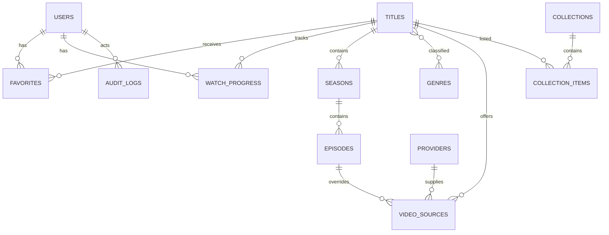

# Cinema MVP — план реализации

## 1. Архитектура

- **Монолит Laravel 13**: REST API `/api/v1`, серверный SEO-shell и Filament 5 в одном приложении.
- **Vue 3 SPA**: Vue Router, Pinia и Vite; API вызывается только через `/api/v1`.
- **Авторизация**: Laravel Sanctum, cookie/session для same-origin SPA, throttling для auth и поиска.
- **Данные**: MySQL 8 в production, SQLite для быстрых локальных тестов; Redis для cache/queue.
- **Интеграции**: backend-адаптер TMDB с `ru-RU` и fallback `en-US`; API key никогда не попадает в frontend.
- **Видео**: цепочка провайдеров через `VideoProviderInterface`; только явно разрешённые источники.
- **Администрирование**: Filament CRUD, роли `admin`, `editor`, `user`, аудит изменений.
- **SEO**: на MVP Laravel отдаёт route-aware title/description/canonical/Open Graph, sitemap и SPA-shell. Полный SSR не выбран, так как он удваивает сложность развёртывания; Nuxt/SSR остаётся production-улучшением после проверки потребности в индексации.

Базовый шаблон использует Laravel 13 и Filament 5 вместо Laravel 12/Filament 4 из ТЗ. Сохраняем более новые совместимые версии, не откатывая starter kit.

## 2. Структура

- `app/Domain/Video` — DTO, enum, интерфейс и выбор провайдера.
- `app/Services/Tmdb` — HTTP-клиент, импорт и синхронизация.
- `app/Http/Controllers/Api/V1` — тонкие REST-контроллеры.
- `app/Http/Resources` — стабильная сериализация API.
- `app/Filament/Resources` — административные CRUD.
- `resources/js` — Vue application, router, stores, views и components.
- `database/migrations`, `database/seeders` — схема и безопасные demo-данные.
- `openapi.yaml` — источник истины API-контракта.

## 3. ERD

Ключевые ограничения: `titles(tmdb_id,type)` unique; `favorites(user_id,title_id)` unique; `watch_progress(user_id,title_id,episode_id)` unique; FK с каскадом для зависимых сущностей, индексы по slug/type/country/user/title.

## 4. API-контракт

Полный контракт хранится в `openapi.yaml`. Единый envelope:

- успех: `{ "data": ..., "meta": {...}, "errors": [] }`;
- ошибка: `{ "data": null, "meta": {}, "errors": [{ "code", "message", "fields"? }] }`.

Маршруты MVP:

- `GET /api/v1/home`, `/titles`, `/titles/{id}`, `/titles/{id}/seasons`, `/search`;
- `GET /api/v1/titles/{id}/watch-options`, `/countries`;
- `POST /api/v1/auth/register`, `/login`, `/logout`;
- `GET|POST|DELETE /api/v1/me/favorites`;
- `GET|PUT /api/v1/me/progress/{titleId}`;
- `PUT /api/v1/me/settings`.

## 5. Пакеты

- PHP: `laravel/sanctum`, существующие Laravel/Filament.
- JS: `vue`, `vue-router`, `pinia`, `axios`, `hls.js`.
- Инфраструктура: Nginx, PHP-FPM, MySQL 8, Redis через Docker Compose.

## 6. Порядок реализации

1. Contract и foundation: схема, модели, роли, Sanctum, API envelope.
2. Catalog: demo seed, ресурсы, фильтры, поиск, home, сериал/эпизоды.
3. Providers: mock direct video, external link, trailer fallback, legal validation.
4. Account: auth, favorites, progress, country.
5. Admin: CRUD и аудит, ограничения ролей.
6. Frontend: dark responsive UI, player, errors, keyboard/remote focus.
7. Operations: Docker, health, sitemap, README, CI.
8. Verification: Pint, PHPUnit, frontend build.

## 7. Риски и решения

- **Нет реальных договоров с провайдерами**: поставляются только demo MP4 от публичного тестового источника, trailer и example external placeholder; production-источники выключены.
- **TMDB key отсутствует**: приложение полностью работает на seed-данных; sync возвращает понятную конфигурационную ошибку.
- **Smart TV отличается по кодекам/HLS**: native playback + HLS.js fallback; проверка на TCL остаётся ручной.
- **SPA SEO ограничен**: метатеги и sitemap покрывают crawlability MVP, но контентный SSR требуется оценить до публичного запуска.
- **Страны и право**: стартовый allowlist СНГ является настройкой, а не юридическим заключением.

## 8. Критерий завершения

Проект устанавливается по README, мигрируется и seed-ится одной командой; API-тесты проходят; frontend собирается; guest/user/editor/admin сценарии доступны; любой watch option честно сообщает `DIRECT`, `EMBED`, `EXTERNAL`, `TRAILER` или `UNAVAILABLE`.
